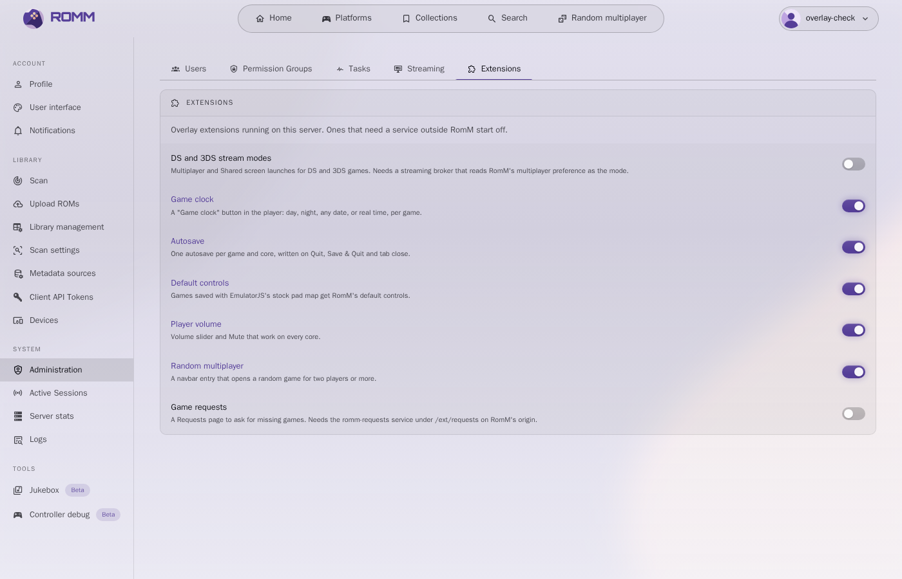
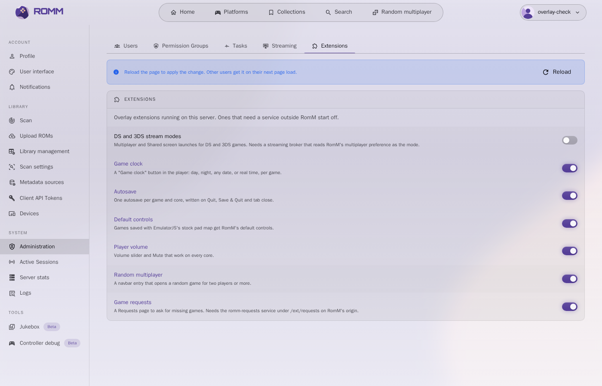

# RomM overlay and patches

Run [RomM](https://github.com/rommapp/romm) with your own frontend changes and
still take every upstream release.

The image is upstream's `rommapp/romm:<version>` with the web app replaced:
rebuilt from upstream's frontend source for the same version after applying a
small patch queue and adding extensions. The backend is upstream's, apart from
one small patch that stores which extensions are switched on.



## Extensions at a glance

| Extension | What it adds | Needs | Default |
|---|---|---|---|
| `player-autosave` | One autosave per game and core, on Quit, Save & Quit and tab close | nothing | on |
| `player-volume` | Volume slider and Mute on every EmulatorJS core | nothing | on |
| `player-controls` | RomM's default pad layout for games saved with EmulatorJS's stock map | nothing | on |
| `game-clock` | A "Game clock" button in the player: day, night, any date | nothing | on |
| `random-multi` | A "Random multiplayer" navbar entry | nothing | on |
| `requests` | A Requests page to ask for missing games | the `services/requests` backend and a download provider | off |
| `ds-modes` | Multiplayer / Shared screen launches for streamed DS and 3DS games | a streaming broker that reads the multiplayer preference as the mode | off |

An admin switches each one on or off in **Administration > Extensions**. The
choice is saved in RomM's `config.yml` (so it needs the config file mounted
writable), applies to every user, and takes effect on the next page load:

```yaml
overlay:
  extensions:
    requests: true
    ds-modes: true
```



An extension the admin never touched keeps its default. The ones that need a
service outside RomM start off, so a plain install shows no page or button
that cannot work.

## How it works

```
upstream source @ ROMM_VERSION
  + patches/*.patch        hook points only, a few lines each
  + ext/<name>/            all real code, as new files (never conflicts)
  -> typecheck, upstream unit tests, vite build
  -> COPY dist and the patched backend files over rommapp/romm:ROMM_VERSION
  -> browser checks against a throwaway RomM
```

- **Patches** (`patches/`) are git diffs against upstream. Keep them to hook
  points: an import and a call. Today there are eight:
  - `0001-ext-install-hook` runs the extensions from `main.ts`, before the
    router is installed.
  - `0002-ext-nav-destinations` lets extensions add entries to the v2 navbar
    (desktop pill and mobile bottom bar).
  - `0003-ext-player-hooks` gives extensions a session in the EmulatorJS
    player (`views/Player/EmulatorJS/Player.vue`, which the v2 player shell
    also uses). The hooks are: set up before EmulatorJS boots, game started,
    Quit, Save & Quit (an extension may store the state itself), and unmount.
  - `0004-ext-view-slots` places `<ExtensionSlot name="..."/>` in two v2
    views: `search.header` (under the search page title) and `game.overview`
    (end of a game page's Overview tab). Slot components read RomM's own
    stores for their context.
  - `0005-ext-game-actions` places a `game.actions` slot after the Stream
    button of a game page (it passes the rom and the button size), lets an
    extension take over the Stream button for a rom (`ownsStream`), and gives
    the Stream button an optional label and icon.
  - `0006-ext-stream-setup` lets an extension that owns a rom's stream
    replace the stream launch screen's multiplayer switch with a
    `stream.setup` slot (it passes the rom).
  - `0007-ext-overlay-config` (backend) reads and writes an
    `overlay.extensions` section of `config.yml`, keeps it when RomM rewrites
    the file for another setting, returns it in `GET /api/config` as
    `OVERLAY_EXTENSIONS`, and adds `PUT /api/config/overlay/extensions/{id}`
    (admins only) to switch one.
  - `0008-ext-admin-extensions-tab` adds the Extensions tab to the v2
    Administration page (admins only).
- **Extensions** (`ext/<name>/extension.ts`) are found automatically. One
  extension can contribute:
  - routes (children of the main layout, rendered by the v2 shell);
  - navbar entries;
  - locale files (`ext/<name>/locales/<locale>/<namespace>.json`, merged into
    upstream's lazy locale loader, used as `t("<namespace>.key")`);
  - player hooks (`player: (context) => session`, see `ext/_core/types.ts`);
  - an `install()` hook for anything else;
  - `defaultEnabled: false` when it needs a service outside RomM (see
    "Extensions at a glance").

  Extensions today:
  - `requests` (off by default): game requests ("Demandes"): a page with IGDB search,
    live request list (SSE) and admin settings, a search fallback slot and a
    "related games missing from the library" slot, all backed by
    `services/requests`.
  - `player-autosave`: one `[autosave]` save state per game and core,
    overwritten on Quit, Save & Quit and tab close. Its preview comes from a
    screenshot cached every 10 s. On a tab close it holds the page behind the
    browser's leave prompt while the upload runs, and ignores EmulatorJS's own
    `exit` teardown, so cancelling the close keeps the game running.
  - `player-volume`: the volume slider and Mute work on every core. The
    nightly EmulatorJS build (loaded when netplay is on) has cores that
    connect audio straight to the destination, past the OpenAL gains
    EmulatorJS sets; the extension routes every destination connection
    through one master gain per AudioContext, installed at app start so
    upstream's netplay audio tap still captures ahead of it.
  - `player-controls`: the default pad layout is RomM's `emulatorjs.controls`
    (Xbox layout by position, players 1 to 4), but EmulatorJS saves the whole
    control map per game in the browser and then ignores the defaults. A
    saved map identical to EmulatorJS's stock one is swapped for the current
    defaults once per game; a map the player changed is kept.
  - `ds-modes` (off by default): a DS or 3DS game streamed from an external
    emulator pool gets launches in place of Stream: Multiplayer, a private screen per player
    whose consoles link over their local wireless, and, for the DS only,
    Shared screen, four DSes in one stream with RomM's invite link for pads. Each sets RomM's "open this
    session to other players" preference, which the broker reads as the mode,
    before launching. On the launch screen that preference shows as the mode
    by name (Multiplayer / Shared screen, with what each means) instead of
    RomM's "Multiplayer mode" switch. Play (in the browser) is unchanged.
  - `game-clock`: a "Game clock" button in the EmulatorJS menu bar. Day
    (today 12:00), Night (today 23:00), any date, or real time, remembered per
    game. It works by offsetting `Date.now`, which is how the cores read the
    time.
  - `random-multi`: a "Random multiplayer" navbar entry. It picks one game
    whose player count goes above 1, on a platform the user can play (browser
    core or stream), and opens its page. `/roms/random` takes no metadata
    filter, so the pick comes from the list endpoint's `rom_id_index`.

  `ext/_core/` is the framework itself. Extensions are written with RomM's own
  v2 components (`@v2/lib`, `@/v2/components/shared`), so they look native and
  follow theme changes.
- **Toolchain** follows upstream: `scripts/build.sh` reads `NODE_VERSION`
  from upstream's Dockerfile for the tag being built.

## Updating to a new RomM release

Renovate bumps `ARG ROMM_VERSION` in the `Dockerfile` and opens a PR. CI then
runs the full chain:

- **Green:** the PR merges and the image is published as
  `<romm-version>-<run>`.
- **Red:** the PR stays open and the deployed image does not change. The
  failing step says what broke:
  - `PATCH FAILED: <name>`: rebase that patch.
  - a type error or a test failure: an extension uses an API that moved.
  - the browser check: an entry no longer renders.

Rebasing a patch:

```sh
scripts/prepare.sh <new-tag> /tmp/romm        # stops at the failing patch
cd /tmp/romm && git apply --3way --reject ../path/to/patches/NNNN-name.patch
# fix the conflict in the file, then regenerate the patch from the diff
git diff -- frontend/src/<file> > path/to/patches/NNNN-name.patch
```

## Adding an extension

```ts
// ext/hello/extension.ts
import { defineExtension } from "../_core/types";

export default defineExtension({
  id: "hello",
  routes: [{ path: "hello", name: "ext-hello", components: { v2: () => import("./Hello.vue") } }],
  navDestinations: [{ id: "hello", labelKey: "ext-hello.title", icon: "mdi-hand-wave", to: "/hello" }],
});
```

Add `ext/hello/locales/en_US/ext-hello.json` with `{ "title": "Hello" }`, give
it a name and a description in `ext/_core/locales/*/ext-core.json` (`"hello"`,
`"hello-desc"`) for the Extensions tab, then add the label to `expected` in
`checks/nav-check.mjs` (or to `switchedOff` if it sets `defaultEnabled: false`).

## Services

`services/requests/` is the backend of the `requests` extension: a Go service
(SQLite, server-sent events) meant to sit on RomM's origin under
`/ext/requests/` (a reverse-proxy path route), so the browser's RomM session
cookie reaches it and it asks RomM `GET /api/users/me` who the caller is.

- `internal/match`: release scoring against a game, rules per platform
  (regions, formats, sizes, seeders), verdict auto / candidate / reject. A
  file of a verified set (TTB's MiNERVA and Internet Archive sources) takes
  its platform from its set folder, needs no seeders, and a plain HTTP one
  ranks above the set torrent; betas, prototypes and samples are never taken
  alone.
- `internal/provider`: the download provider interface; `provider/ttb`
  implements it on TorrentTrackerBrowser (SSE search, jobs, purge). Another
  provider (Prowlarr + qBittorrent) only has to implement the interface.
- `internal/engine`: the request lifecycle (search, pick or ask, wanted list
  with back-off, download progress, import, link to RomM, extras as child
  requests).
- `internal/importer`: unpack (7z), keep the game files, optional CHD
  (chdman, throttled), place without overwriting, call the scan hook.

Environment: `ROMM_URL`, `ROMM_TOKEN` (roms.read, roms.write, platforms.read),
`IGDB_CLIENT_ID`, `IGDB_CLIENT_SECRET`, `TTB_URL`, `TTB_STORAGE` (staging
storage), `STAGING_ROOT` and `LIBRARY_ROOT` (the same filesystem, mounted
once, so placing is a rename), `SCAN_HOOK_URL`, `NTFY_URL`, `NTFY_TOKEN`,
`PUBLIC_URL`, and optionally `LISTEN`, `BASE_PATH`, `DB_PATH`. Everything else
(rules, provider, schedule, notifications) is in the admin settings. CI builds it (vet and tests run in
the image build) and publishes `romm-requests:1.0.<run>` next to the overlay
image.

## Building and checking locally

```sh
scripts/build.sh 5.4.1 romm-overlay   # needs Docker
checks/run.sh romm-overlay:5.4.1      # throwaway RomM + headless Chromium
SCREENSHOTS=$PWD/shots checks/run.sh romm-overlay:5.4.1   # also saves screenshots
```

The check asserts that the extensions that start off are absent, switches them
on in Administration > Extensions, and then opens their pages too.

Only the v2 UI (RomM's default since 5.3) gets navbar entries. v1 users can
still open an extension's page by its URL.

## CI

`.forgejo/workflows/build.yml` runs on a Forgejo Actions runner labelled
`romm-overlay` in host mode (it needs Docker). Configure:

| | Name | Purpose |
|---|---|---|
| Variable | `REGISTRY_IMAGE` | e.g. `forgejo.example.com/owner/romm-overlay` |
| Secret | `REGISTRY_USER`, `REGISTRY_TOKEN` | push to that registry |
| Secret | `NTFY_URL`, `NTFY_TOKEN` | optional failure notification |
